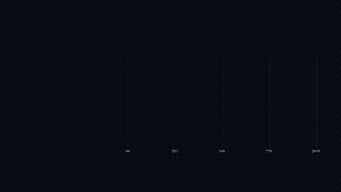

# Cua Driver Bench: videos

Short films about [Cua Driver Bench](https://github.com/trycua/cua/tree/main/libs/cua-driver-bench): can a computer-use driver let an agent finish real desktop tasks while you keep working in front of the same computer, without disturbing you and without cheating through a shell? A trial is a **full pass** only if the task is done, the agent stayed GUI-only, and in the background condition the user was undisturbed.

The films were made with Scale AI and AgentEnv, who ran the benchmark. Every number comes from the public dataset [earakely-scale/CuaDriverBench-AgentEnv](https://huggingface.co/datasets/earakely-scale/CuaDriverBench-AgentEnv) (its `results/board.parquet`, read on **2026-11-11**), and the dataset's [replay Space](https://huggingface.co/spaces/earakely-scale/CuaDriverBench-AgentEnv) plays every trial.

**The numbers** (macOS, background full pass, 40 trials per driver, Claude Sonnet 5.5): Cua Driver 23 of 40 (58%), Codex Computer Use 11 of 40 (28%), Vercel Labs agent-desktop 8 of 40 (20%), browser-use 1 of 40 (3%). Windows films use Windows trials from the same dataset; Codex Computer Use is foreground-only on Windows, so no Windows background comparison with it is shown. These are AgentEnv's runs, **not like-for-like with Cua's own runner**, the Cua Driver and Codex Computer Use gap is **directional** (the intervals overlap), and other models rank the drivers differently, so every film names the model. We build Cua Driver. Other drivers' names are plain text.

All films are 1920x1080 at 60 fps with a synthesised sound bed (no voice). The cells below show a silent looping preview; click one to open the full mp4 (GitHub's file view plays it with sound and controls).

<table>
<tr>
<td valign="top">

<a href="videos/hands-off.mp4"></a>

**[Hands off](videos/hands-off.mp4)** (16 s)<br>Someone types while Cua Driver finishes tasks in three apps behind them; the caret never moves. 58% badge (no baseline: the A variants add one).<br><sub>Swaps with numbers: Only the "58%" badge text in `source/lib/videos/hands-off.js`.</sub>

</td>
<td valign="top">

<a href="videos/hands-off-bumper.mp4"></a>

**[Hands off, bumper](videos/hands-off-bumper.mp4)** (6 s)<br>The same scene compressed for a short loop; ends on Cua Driver Bench.<br><sub>Swaps with numbers: Same badge text as Hands off.</sub>

</td>
</tr>
<tr>
<td valign="top">

<a href="videos/hands-off-a1.mp4"></a>

**[Hands off A1: mini comparison](videos/hands-off-a1.mp4)** (16 s)<br>Same film; the badge becomes Cua Driver 58% next to Codex Computer Use 28%, agent-desktop 20%, browser-use 3% (macOS, Claude Sonnet 5.5), with the dataset source and "directional".<br><sub>Swaps with numbers: Every driver's `passed`/`n` in `numbers.json`.</sub>

</td>
<td valign="top">

<a href="videos/hands-off-a2.mp4"></a>

**[Hands off A2: more than 1.7x](videos/hands-off-a2.mp4)** (16 s)<br>Same film; "more than 2x Codex Computer Use, on macOS" with two bars (23/40 vs 11/40, directional); the ratio text is computed.<br><sub>Swaps with numbers: First two drivers' `passed`/`n`; the ratio is computed.</sub>

</td>
</tr>
<tr>
<td valign="top">

<a href="videos/hands-off-a3.mp4"></a>

**[Hands off A3: 40 trial tiles](videos/hands-off-a3.mp4)** (16 s)<br>Same film; two grids of 40 tiles, 23 green for Cua Driver beside 11 for Codex Computer Use.<br><sub>Swaps with numbers: First two drivers' `passed`/`n`.</sub>

</td>
<td valign="top">

<a href="videos/race.mp4"></a>

**[The race](videos/race.mp4)** (15 s)<br>Four drivers race over eight tasks; bars end at the final full-pass rates, with k/n and who ran each.<br><sub>Swaps with numbers: Everything numeric, from `numbers.json` (lengths, %, k/n, sources, lane order).</sub>

</td>
</tr>
<tr>
<td valign="top">

<a href="videos/ask-race.mp4"></a>

**[Ask: fight, question, race](videos/ask-race.mp4)** (20 s)<br>About 4 s of two koala bots fighting over one cursor, "How often do you fight with your agent for the cursor?", "We made Cua Driver Bench to find out.", then the race.<br><sub>Swaps with numbers: Result half: `numbers.json`. The opener has no numbers.</sub>

</td>
<td valign="top">

<a href="videos/ask-score.mp4"></a>

**[Ask: fight, question, scoreboard](videos/ask-score.mp4)** (20.7 s)<br>Same opener, resolving into the scoreboard.<br><sub>Swaps with numbers: Result half: `numbers.json`.</sub>

</td>
</tr>
<tr>
<td valign="top">

<a href="videos/scoreboard.mp4"></a>

**[Scoreboard](videos/scoreboard.mp4)** (16 s)<br>Broadcast-style leaderboard with live re-sorting ranks, a ticker with the caveats, and the final lines for the top two (23 vs 11 of 40, directional).<br><sub>Swaps with numbers: Rows, ranks, % and the lead line, from `numbers.json`.</sub>

</td>
<td valign="top">

<a href="videos/focus-ring.mp4"></a>

**[Focus ring](videos/focus-ring.mp4)** (16 s)<br>A person's focus ring stays full while five background windows finish; ends on 58% with the baseline row.<br><sub>Swaps with numbers: Baseline row from `numbers.json`; the "58%" end-card text is in `focus-ring.js`.</sub>

</td>
</tr>
<tr>
<td valign="top">

<a href="videos/rerun.mp4"></a>

**[Rerun it yourself](videos/rerun.mp4)** (12 s)<br>Points at the CuaDriverBench-AgentEnv dataset on Hugging Face (instructions for each OS and driver); shows two commands from its card (the Linux/Docker run and loading the board); thanks to Scale AI.<br><sub>Swaps with numbers: Nothing (no numbers).</sub>

</td>
<td valign="top">

<a href="videos/desks.mp4"></a>

**[One driver, every desk](videos/desks.mp4)** (16 s)<br>macOS, Windows and Linux desks, one task finishing on each, no scores for Windows or Linux; ends on macOS 58% with the baseline.<br><sub>Swaps with numbers: Baseline row from `numbers.json`.</sub>

</td>
</tr>
<tr>
<td valign="top">

<a href="videos/interruptions.mp4"></a>

**[Count the interruptions](videos/interruptions.mp4)** (16 s)<br>Counts of macOS background trials (of 40) where the dataset marks the user as disturbed: browser-use 39, Codex Computer Use 29, agent-desktop 19, Cua Driver 4; then the baseline.<br><sub>Swaps with numbers: `drivers[].disturbed` and `passed`/`n` in `numbers.json`.</sub>

</td>
<td valign="top">

<a href="videos/dear-agent.mp4"></a>

**[Dear agent](videos/dear-agent.mp4)** (16 s)<br>A typed note ("please do not touch my cursor"), then the result with its baseline.<br><sub>Swaps with numbers: Baseline row from `numbers.json`.</sub>

</td>
</tr>
<tr>
<td valign="top">

<a href="videos/ask-room.mp4"></a>

**[Ask the room](videos/ask-room.mp4)** (16 s)<br>A poll card, six koala bots answer "Yes" (no percentages), then the bench result with the baseline.<br><sub>Swaps with numbers: Baseline row from `numbers.json`.</sub>

</td>
<td valign="top">

<a href="videos/eight-tasks.mp4"></a>

**[Eight tasks](videos/eight-tasks.mp4)** (16 s)<br>The eight tasks as stickers stamped with Cua Driver's passes out of 5 (1, 0, 4, 4, 4, 5, 5, 0), zeros included; then the baseline.<br><sub>Swaps with numbers: `drivers[0].per_task` and `passed`/`n` in `numbers.json`.</sub>

</td>
</tr>
<tr>
<td valign="top">

<a href="videos/driver-or-model.mp4"></a>

**[Driver or model? (Windows)](videos/driver-or-model.mp4)** (16 s)<br>Windows, background full pass for six models: Cua Driver 8-11 of 40 each, Vercel Labs agent-desktop 0 of 40 each. The model barely moves it; the driver does.<br><sub>Swaps with numbers: `windows.drivers[...].bg` in `numbers.json`.</sub>

</td>
<td valign="top">

<a href="videos/both-ways.mp4"></a>

**[Both ways (Windows, Opus 5.5)](videos/both-ways.mp4)** (16 s)<br>Foreground: agent-desktop 45/50 vs Cua Driver 37/50 (agent-desktop ahead, credited). Background: Cua Driver 10/40 vs agent-desktop 0/40.<br><sub>Swaps with numbers: `windows.drivers[...].fg/bg` in `numbers.json`.</sub>

</td>
</tr>
<tr>
<td valign="top">

<a href="videos/swap-one.mp4"></a>

**[Swap one thing (Windows)](videos/swap-one.mp4)** (16 s)<br>Opus vs Haiku, Cua Driver vs agent-desktop, foreground and background, with the swap deltas computed on screen: in the foreground both matter, in the background the driver does.<br><sub>Swaps with numbers: `windows.drivers[...].fg/bg` in `numbers.json`.</sub>

</td>
</tr>
</table>

## Data-driven
`source/numbers.json` is the one data file; `source/tools/gen_numbers.py` regenerates it from the dataset's `results/board.parquet`. Edit it and re-render and every number-bearing film follows (bars, percentages, trial counts, the "more than 2x" text, Windows comparisons).

## Rebuild
```bash
cd source
pip install -r tools/requirements.txt && python -m playwright install chromium   # Python 3.13, Playwright 1.55.0, numpy 2.3.1, scipy 1.15.3, soundfile 0.13.1, Pillow 12.2.0; ffmpeg 8.0 on PATH
python tools/gen_numbers.py board.parquet numbers.json 2026-11-11   # optional: rebuild numbers.json from the dataset's results/board.parquet
python tools/audio.py race                             # any name in CUES (see tools/audio.py)
python tools/render.py --video race --workers 8        # frames in renders/frames/race (60 fps), numbers from numbers.json
python tools/encode.py race 12.5 race ../out           # 5 Mbps mp4 + poster
```
Variants: `--video hands-off --variant a1` (a2, a3, bumper), `--video two-cursors+race+ask --variant intro` (audio name `ask-race`), `--video two-cursors+scoreboard+ask --variant intro` (audio `ask-score`; copy `renders/ask-score.wav` to `renders/two-cursors+scoreboard+ask-intro.wav` before `encode.py`). Rendering is CPU-only (headless Chromium, `--disable-gpu`); every frame is a pure function of time. The audio is measured, not yet reviewed by a person.

## Licence and attribution
- The film code, scenes and scripts in this repository are released under the MIT licence (`LICENSE`).
- The benchmark's tasks, apps and evaluators are trycua's, under FSL-1.1-MIT, and are **not included** here; see [trycua/cua](https://github.com/trycua/cua/tree/main/libs/cua-driver-bench) and the dataset linked above. The dataset's recordings and grades are Apache-2.0 per its card.
- Fonts: Urbanist and JetBrains Mono, SIL Open Font License 1.1, with the licence texts next to the font files (`source/lib/fonts/OFL-*.txt`).
- The koala-bot head, ear, nose and ray shapes in `source/lib/koalabot-data.js` and the Cua mark in `source/lib/mark.js` are Cua's artwork.

## Trademarks
Scale AI's logo (`source/lib/assets/scale-logo-horizontal-*.svg`, from brand.scale.com) and the AgentEnv mark (`source/lib/assets/agentenv-icon.svg`, from agentenvframework.com) are their owners' trademarks. They appear on the end cards, unmodified, to show their involvement as the benchmark's partners, and are included only under their owners' terms; they are not covered by this repository's MIT licence. **Scale's brand guidelines ask that every partner lockup go through Scale's brand review before it ships; that review was not confirmed when this repository was published.** The Cua name and mark are Cua AI, Inc.'s. Other drivers (Codex Computer Use, Vercel Labs agent-desktop, browser-use) are named as plain text and their trademarks belong to their owners; no affiliation is implied.
